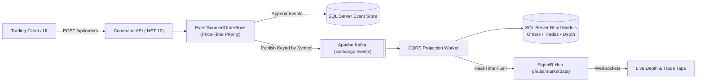

# Event-Driven Trading Exchange (.NET 10 • Kafka • SQL Server 2025 • SignalR)

[](https://github.com/Dvmisani/Event-Driven-Trading-Exchange/actions/workflows/ci.yml)

Simplified institutional backend trading exchange modeled on **JSE**, **NASDAQ**, and **Binance** market mechanics—built with **C# / .NET 10**, **Event Sourcing**, **CQRS**, **Apache Kafka**, **SQL Server 2025**, and **SignalR WebSockets**.

## Core Engineering Patterns

- **Price-Time Priority Matching Engine:** Matches aggressive orders against resting limit books (`Bids` descending, `Asks` ascending, FIFO within price levels) at the resting maker's price.
- **Pure Event Sourcing:** `EvaluatePlaceOrder` and `EvaluateCancelOrder` never mutate state; every action emits immutable domain events (`OrderPlaced`, `OrderMatched`, `TradeExecuted`, `OrderCancelled`) persisted to an append-only SQL Server Event Store and replayable on startup or via `/api/admin/rebuild/{symbol}`.
- **Strict CQRS + Apache Kafka:** Commands write to the Event Store and publish keyed by `Symbol` to Kafka (`exchange.events`), while an idempotent `BackgroundService` consumer projects read models (`Orders`, `Trades`, `DepthLevels`).
- **Real-Time SignalR Market Data:** Pushes live order book depth snapshots (`OrderBookUpdated`) and trade ticks (`TradeExecuted`) over WebSockets to subscribed clients (`/hubs/marketdata`).

## System Architecture



## API Endpoints & Quickstart

| Method | Endpoint | Side | Description |
| :--- | :--- | :--- | :--- |
| `POST` | `/api/orders` | Command | Submit limit `Buy` / `Sell` order; returns emitted domain events |
| `DELETE` | `/api/orders/{symbol}/{orderId}` | Command | Cancel active resting order and emit `OrderCancelled` |
| `POST` | `/api/admin/rebuild/{symbol}` | Admin | Replay SQL Server event stream from sequence `1` to rebuild state |
| `GET` | `/api/marketdata/{symbol}/orderbook` | Query | Aggregated L2 order book depth (`Bids` and `Asks`) |
| `GET` | `/api/marketdata/{symbol}/trades` | Query | Recent executed trades tape |
| `GET` | `/api/marketdata/{symbol}/events` | Query | Immutable ordered event store log |

```bash
# Run full stack (API on :5080, Kafka UI on :8085, SQL Server 2025 on :1433)
docker compose up --build

# Run unit replay + end-to-end Testcontainers suite
dotnet test --nologo --logger "console;verbosity=normal"
```

## Kafka Partitioning & Fault-Tolerance Architecture

All domain events are published to `exchange.events` using `Key = Symbol` (Murmur2 consistent hashing) with `Acks = All` and `EnableIdempotence = true`:

```text
AAPL   ──▶ Partition 1 ──▶ Strict FIFO per-symbol order lifecycle (OrderPlaced → OrderMatched → TradeExecuted)
MSFT   ──▶ Partition 2 ──▶ Parallel horizontal throughput without cross-symbol lock contention
BTCUSD ──▶ Partition 3 ──▶ Independent consumer scaling across partition groups
```

- **End-to-End Idempotency:** Command retries carrying `ClientRequestId` (or `X-Idempotency-Key`) return the cached response without duplicate matching, while `ProjectionApplier` deduplicates at-least-once Kafka deliveries by `EventId`.
- **Dead Letter Queue (`exchange.events.deadletter`):** Poison or malformed messages failing bounded projection retries are routed to `exchange.events.deadletter` (and logged in SQL Server `/api/admin/deadletters`) before committing the partition offset so one bad payload never stalls an entire symbol stream.

## Observability: OpenTelemetry, Jaeger, Prometheus & Grafana

- **End-to-End Distributed Tracing (`TradingExchange.Engine`):** Propagates W3C `traceparent` headers across Kafka message headers to link `OrderSubmission` → `MatchingEngine` → `KafkaPublish` → `ProjectionProcessing` → `SignalRBroadcast` into a single unified waterfall trace in **Jaeger UI** (`http://localhost:16686`).
- **Prometheus Metrics (`/metrics`):** Exposes `exchange_orders_submitted_total`, `exchange_trades_executed_total`, `exchange_matching_latency_ms`, `exchange_projection_lag_ms`, `exchange_kafka_messages_published_total`, `exchange_kafka_messages_consumed_total`, and `exchange_signalr_active_connections` scraped by **Prometheus** (`http://localhost:9090`).
- **Pre-Provisioned Grafana Dashboard (`http://localhost:3000`):** Auto-provisions the *Event-Driven Trading Exchange — Live Telemetry* board with live panels for Orders/sec, Trades/sec, Kafka throughput, p95 Projection Lag, p95 Matching Latency, and active SignalR subscribers.

## Performance Benchmarks (NBomber)

Measured locally using **NBomber** on **Intel(R) Core(TM) i5-10310U CPU @ 1.70GHz** (15.8 GB RAM, `.NET 10.0.15`):

| Metric | Target | Measured Result | Latency (Mean / p95) | Status |
| :--- | :--- | :--- | :--- | :--- |
| **Order Submissions & Matching** | `10,000+ orders/sec` | **113,123 orders/sec** | `0.14 ms` / `0.01 ms` | PASS |
| **Matching Engine Latency** | `< 5.00 ms` | **0.14 ms** (p99: `0.38 ms`) | `0.00 ms` p50 | PASS |
| **Event Stream Replay Speed** | `100,000+ events/sec` | **1,924,082 events/sec** (250,000 events in `129.9 ms`) | `0.52 µs/event` | PASS |
| **SignalR Market Data Broadcasts** | `1,000+ broadcasts/sec` | **891,297 broadcasts/sec** | `0.02 ms` / `0.02 ms` | PASS |
