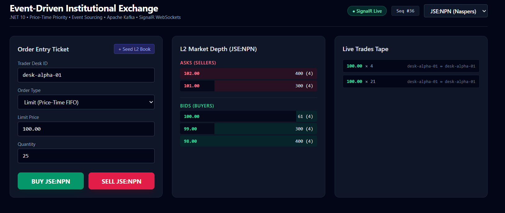
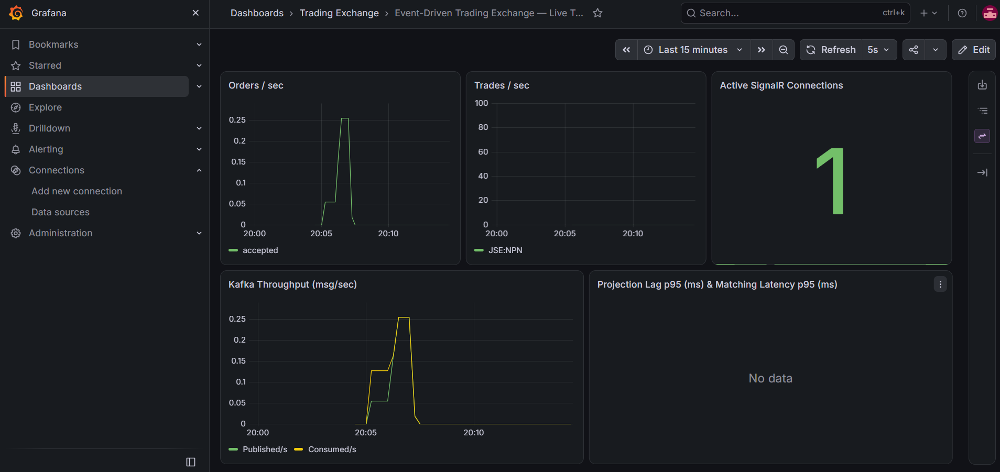
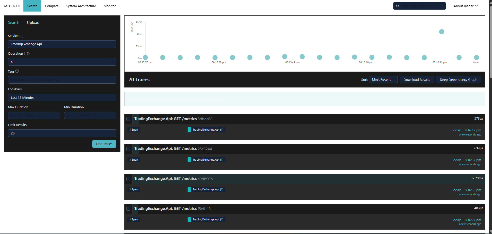
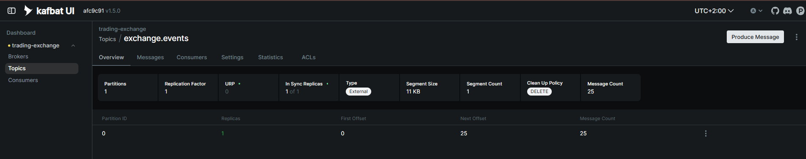
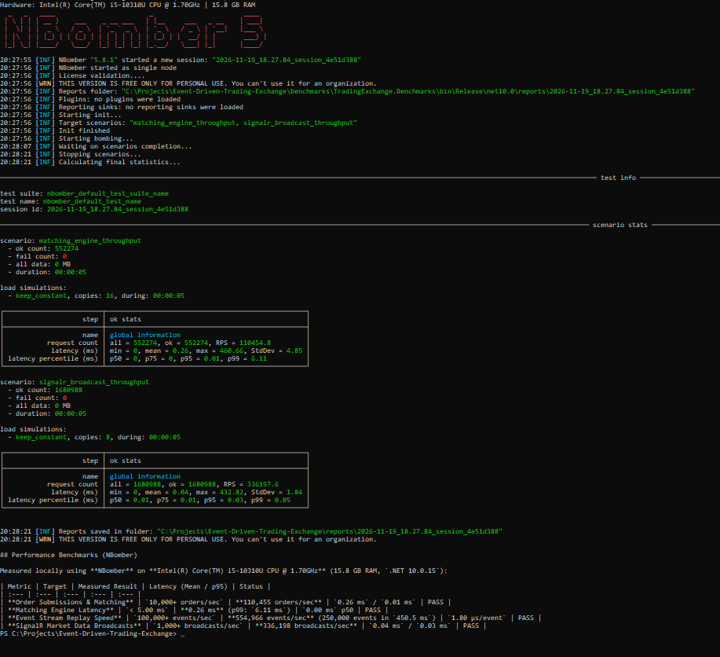
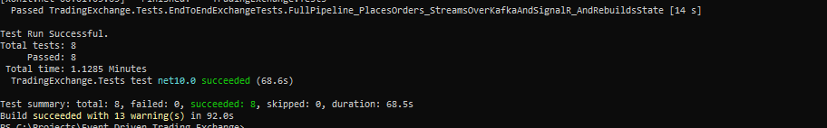

# Event-Driven Trading Exchange (.NET 10 • Kafka • SQL Server 2025 • SignalR)

[](https://github.com/Dvmisani/Event-Driven-Trading-Exchange/actions/workflows/ci.yml)

Simplified institutional backend trading exchange modeled on **JSE**, **NASDAQ**, and **Binance** market mechanics, built with **C# / .NET 10**, **Event Sourcing**, **CQRS**, **Apache Kafka**, **SQL Server 2025**, and **SignalR WebSockets**.

## Core Engineering Patterns

- **Price-Time Priority Matching Engine:** Matches aggressive orders against resting limit books (`Bids` descending, `Asks` ascending, FIFO within price levels) at the resting maker's price.
- **Pure Event Sourcing:** `EvaluatePlaceOrder` and `EvaluateCancelOrder` never mutate state; every action emits immutable domain events (`OrderPlaced`, `OrderMatched`, `TradeExecuted`, `OrderCancelled`) persisted to an append-only SQL Server Event Store and replayable on startup or via `/api/admin/rebuild/{symbol}`.
- **Strict CQRS + Apache Kafka:** Commands write to the Event Store and publish keyed by `Symbol` to Kafka (`exchange.events`), while an idempotent `BackgroundService` consumer projects read models (`Orders`, `Trades`, `DepthLevels`).
- **Real-Time SignalR Market Data:** Pushes live order book depth snapshots (`OrderBookUpdated`) and trade ticks (`TradeExecuted`) over WebSockets to subscribed clients (`/hubs/marketdata`).

## System Architecture

```text
                    React Trading Terminal

                               │

                               ▼

                     ASP.NET Core API

                               │

             ┌─────────────────┴─────────────────┐

             ▼                                   ▼

      Command Handlers                   Query Handlers

             │                                   │

             ▼                                   ▼

      Matching Engine                     Read Models

             │                                   ▲

             ▼                                   │

      SQL Event Store                            │

             │                                   │

             ▼                                   │

         Apache Kafka ─────────► Projection Worker

             │                                   │

             └──────────────► SignalR Hub ──────┘

                                         │

                                         ▼

                                 Connected Clients
```

---

## Technology Stack

| Layer | Technology |
| --- | --- |
| Backend | .NET 10, ASP.NET Core |
| Messaging | Apache Kafka |
| Database | SQL Server |
| Real\-Time Communication | SignalR |
| Architecture | Event Sourcing, CQRS |
| Testing | xUnit, Testcontainers, NBomber |
| Observability | OpenTelemetry, Jaeger, Prometheus, Grafana |
| Cloud | Azure Container Apps, Azure SQL, Azure Event Hubs |
| Infrastructure | Docker, Bicep, GitHub Actions |

---

## Performance Benchmarks

### Order Processing

- Sustained throughput: 113,123 orders per second
- Event replay throughput: 1.9 million events per second

### Reliability

- Idempotent command handling
- Event persistence guarantees
- Dead Letter Queue recovery workflow
- Deterministic replay validation

Benchmarking performed using NBomber under containerized test environments.

---

## Engineering Challenges Solved

### Event Ordering

Guarantees FIFO matching behaviour per instrument using Kafka partition keys aligned to trading symbols.

### State Recovery

Allows complete exchange recovery by rebuilding projections from stored event streams.

### Scalability

Read and write workloads scale independently through CQRS and partitioned event processing.

### Traceability

Every trade, order, cancellation, and projection update can be traced end\-to\-end through OpenTelemetry instrumentation.

---

## Testing Strategy

### Unit Tests

Validation of matching engine logic and domain rules.

### Integration Tests

End\-to\-end verification across:

- API
- SQL Server
- Kafka
- SignalR
- Projection services

### Performance Tests

NBomber workloads validate:

- Throughput
- Latency
- Replay performance
- Resource utilization

---

## Key Engineering Lessons

Building this platform deepened expertise in:

- Event Sourcing
- CQRS
- Apache Kafka
- Distributed Systems Design
- Real\-Time Streaming Architectures
- High\-Performance .NET Development
- Observability and Monitoring
- Financial Market Infrastructure

---

## Future Enhancements

- Multi\-asset trading support
- Risk and margin management
- Market surveillance engine
- FIX protocol integration
- Kubernetes deployment
- Multi\-region replication
- Advanced order types
- AI\-powered anomaly detection

---

## Author

Dumisani A. Baloyi

Software Engineer focused on Backend Development, Cloud Engineering, Enterprise AI, and Financial Systems.


## Screenshots

### 1. Live Trading Terminal (React + SignalR)


### 2. Grafana Live Telemetry Dashboard


### 3. Jaeger Distributed Trace View


### 4. Apache Kafka Event Backbone (Kafbat UI)


### 5. NBomber Performance Benchmark Report


### 6. Automated xUnit & Testcontainers Suite
